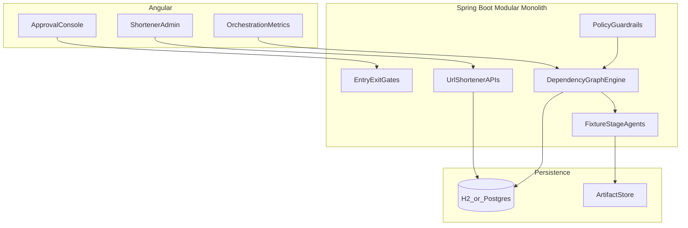

# Agentic URL Shortener

A working prototype that turns a natural-language engineering requirement into a reviewable SDLC outcome through a governed agentic orchestration layer, demonstrated against a Java/Angular URL shortener domain.

## Context

| Item | Value |
|---|---|
| Stack | Java 21, Spring Boot 4.1.1, Angular 20.3, Postgres, Redis |
| Agent mode | Deterministic fixture agents (`AGENT_MODE=fixture`) |
| Version | 1.0.0-SNAPSHOT |

## Prerequisites

- JDK 21+
- Maven 3.9+
- Node.js 20+
- Docker Desktop 4+ (optional, for Compose stack)
- Python 3 (optional, for demo script JSON parsing)

## Quick Start

### Local (H2, no Redis)

```bash
cd backend
mvn spring-boot:run
```

In another terminal:

```bash
cd frontend
npm install
npm start
```

Open `http://localhost:4200`. Backend API listens on `http://localhost:8080`.

### Docker Compose

```bash
cp .env.example .env
docker compose up --build
```

- UI: `http://localhost:4200`
- API: `http://localhost:8080`
- Artifacts written to `./artifacts/<runId>/`

### Demo the three scenarios

With the backend running:

```bash
chmod +x scripts/demo-scenarios.sh
./scripts/demo-scenarios.sh
```

The script starts greenfield, brownfield, and ambiguous runs, auto-approves gated stages, and prints engineering summaries.

## Architecture



### Bounded contexts

- `urlshortener`: create/redirect/analytics/export, URL policy validation, rate limiting
- `orchestration`: DAG executor, entry/exit gates, human approvals, retries, rollback, safe-stop, re-plan, audit lineage, metrics

### Orchestration model

Stages form an explicit dependency graph (not a linear script):

- sequential edges via `dependsOn`
- parallel implement stages run concurrently (task executor) with a sync barrier into testing
- human approval checkpoints for high-impact stages
- policy guardrails on entry/exit (secrets redaction, release must be gated)
- bounded retries with failure logs fed back into implement/test agent context; exhaustion triggers automated rollback and pauses for human replan
- optional testing failure injection via `TESTING_FAIL_UNTIL_ATTEMPT` to demo the retry/replan loop offline
- audit-grade lineage at every state transition: prompt/response history, dependency graph, gate decisions, MTTR, retry counts, agent latency
- Micrometer metrics: success rate, retries, rollbacks, MTTR, latency
- ambiguous release gates enforced in `PolicyGuardrails`: security, compliance (`criticalVulns`), and SLO (`p99RedirectLatencyMs` under 10 ms)

## API surface

| Method | Path | Purpose |
|---|---|---|
| POST | `/api/v1/urls` | Create short URL |
| GET | `/r/{code}` | Redirect + track click |
| GET | `/api/v1/urls/{code}/analytics` | Analytics |
| GET | `/api/v1/urls/{code}/analytics/export` | Export rows |
| POST | `/api/v1/orchestration/runs` | Start scenario run |
| GET | `/api/v1/orchestration/runs/{id}` | Run + stage graph |
| POST | `/api/v1/orchestration/runs/{id}/stages/{stageId}/decision` | Approve/reject gate |
| POST | `/api/v1/orchestration/runs/{id}/safe-stop` | Safe stop |
| POST | `/api/v1/orchestration/runs/{id}/rollback` | Rollback |
| POST | `/api/v1/orchestration/runs/{id}/replan` | Re-plan |
| GET | `/api/v1/orchestration/metrics` | Reliability metrics |

## Testing approach

```bash
cd backend && mvn test
cd frontend && npm test -- --watch=false --browsers=ChromeHeadless
```

Backend coverage focuses on:

- happy/sad URL create paths and private-host rejection
- redirect click tracking
- greenfield / brownfield / ambiguous orchestration paths
- gate approve/reject, safe-stop, rollback
- injected testing failures with retry recovery and auto-rollback on exhaustion
- ambiguous security / compliance / SLO release gate policy

## Configuration

Copy `.env.example`. Do not commit secrets.

| Variable | Default | Meaning |
|---|---|---|
| `AGENT_MODE` | `fixture` | Deterministic agents for offline demos |
| `REDIS_ENABLED` | `false` | Enable Redis-backed rate limiting |
| `CORS_ORIGINS` | `http://localhost:4200` | Explicit CORS allow-list |
| `ARTIFACTS_DIR` | `./artifacts` | Stage artifact output |
| `TESTING_FAIL_UNTIL_ATTEMPT` | `0` | Fail testing while attempt is below this value (demo retries) |
| `REQUIRE_LOCAL_ADMIN` | `false` | When true, orchestration POSTs must come from loopback |

## Risks, trade-offs, limitations

- Fixture agents are deterministic by design; live LLM integration is a seam (`FixtureStageAgentRegistry`) and intentionally not required for the demo.
- Agents propose artifacts; humans own release-class approvals.
- In-process DAG engine favors clarity over a Temporal/Camunda deployment for a 2–3 day prototype.
- Redis is optional; local rate limiting falls back to an in-memory window.
- Ambiguous requirements are resolved by recording assumptions rather than blocking indefinitely.

## Common issues

- If port 8080 is busy, change `server.port` or stop the conflicting process.
- Angular cannot reach the API: confirm backend health at `/actuator/health` and CORS origin.
- Docker frontend build fails: ensure `package-lock.json` exists (`npm install` once locally).

## Scenario notes

See [docs/scenarios.md](docs/scenarios.md) for greenfield, brownfield, and ambiguous playbooks, including:

- greenfield testing sync-barrier retry/re-plan/rollback loop
- lineage recording shared across all scenarios
- formal security, compliance, and SLO gate policies for the ambiguous scenario